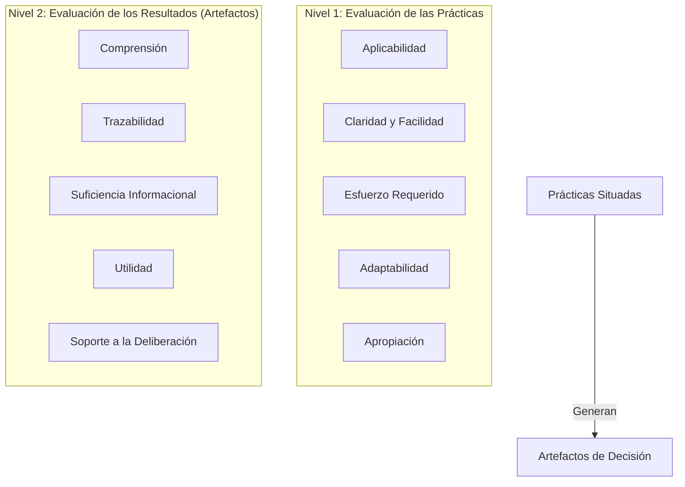

# Criterios y Niveles de Evaluación

## La Evaluación en Dos Niveles

En investigaciones de diseño organizacional e intervención sociotécnica, reducir la evaluación a la opinión de los usuarios sobre un diagrama final distorsiona el análisis y oscurece el papel del proceso. 

Para asegurar rigor metodológico y coherencia con Action Design Research (ADR), esta investigación implementa un **esquema de evaluación estructurado en dos niveles complementarios**:

---

## Detalle de Dimensiones y Criterios

### Nivel 1: Evaluación de las Prácticas
Examina la ejecución misma de las acciones situadas en los episodios de decisión:

- **Aplicabilidad**: Grado en que las prácticas candidatas pueden ser ejecutadas en el contexto real de la empresa sin fricciones artificiales.
- **Claridad y facilidad de ejecución**: Nivel de comprensión que los participantes tienen sobre el propósito, insumos, actividades y roles requeridos en cada práctica.
- **Esfuerzo requerido**: Cantidad de tiempo, sesiones de trabajo y recursos dedicados a caracterizar la decisión, aplicar IMS y estructurar relaciones.
- **Adaptabilidad**: Capacidad de las prácticas para ajustarse según las particularidades de la decisión (urgencia, nivel de incertidumbre, actores técnicos o de negocio).
- **Apropiación**: Grado en que los participantes asumen y aplican de manera autónoma los principios y lógicas de las prácticas en su trabajo diario.

### Nivel 2: Evaluación de los Resultados (Artefactos de Decisión)
Analiza las cualidades y el impacto inmediato de las representaciones producidas:

- **Comprensión de la situación**: Capacidad del artefacto para hacer inteligible el problema a participantes con diferente nivel de especialización.
- **Trazabilidad de relaciones**: Visibilidad explícita de los vínculos socio-técnicos entre actividades operativas, herramientas, sistemas, métricas y restricciones ($M:N$).
- **Suficiencia informacional**: Percepción de los actores sobre si la información presentada es completa respecto a lo necesario para decidir, sin presentar baches críticos ni sobrecarga innecesaria.
- **Utilidad**: Pertinencia del artefacto para evaluar opciones, identificar riesgos y estructurar el análisis.
- **Soporte a la deliberación**: Eficacia del artefacto como *Boundary Object* para mediar el diálogo, alinear consensos y documentar acuerdos entre áreas.

---

## Separación Metodológica: IMS vs. Suficiencia Informacional

Para prevenir la circularidad metodológica (validar el resultado empleando idéntico criterio al usado para construirlo), la investigación establece una estricta distinción:

| Dimensión | IMS (Criterio de Construcción) | Suficiencia Informacional (Resultado Evaluado) |
| :--- | :--- | :--- |
| **Momento** | *Ex ante* y concurrente durante la recolección. | *Ex post* tras finalizar y presentar el artefacto. |
| **Función** | Regla operativa de parada para delimitar el alcance y no recolectar datos exhaustivos. | Juicio valorativo de los actores sobre si contaron con la información indispensable para deliberar. |
| **Sujeto evaluador** | El facilitador/arquitecto guiando la práctica. | Los actores deliberantes (decisores, negocio, TI). |

---

## Delimitación del Alcance Evaluativo

La evaluación no busca probar relaciones causales directas sobre el desempeño financiero futuro de la organización ni pretende afirmar que las prácticas garantizan automáticamente "mejores decisiones". 

El alcance se restringe científicamente a los efectos directamente observables en el proceso de decisión: **mejorar la comprensión de la situación, hacer visibles las dependencias, garantizar trazabilidad y enriquecer la deliberación compartida**.
