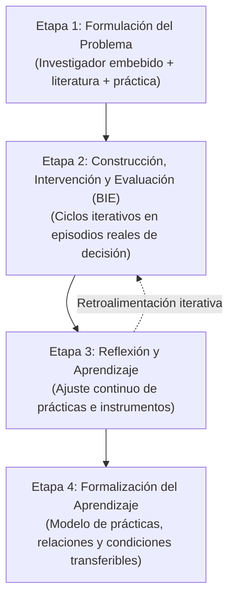

# Action Design Research (ADR)

## De DSR Tradicional a Action Design Research

En las etapas iniciales de la tesis doctoral se contempló el enfoque de *Design Science Research* (DSR) clásico. Sin embargo, a medida que la investigación maduró y delimitó su objeto de estudio hacia las **prácticas de arquitectura empresarial como acciones situadas**, se hizo evidente la necesidad de un enfoque metodológico más adecuado: **Action Design Research (ADR)** (Sein et al., 2011).

Mientras que el DSR tradicional concibe frecuentemente los artefactos como herramientas tecnológicas diseñadas de manera aislada para luego ser introducidas y evaluadas en una organización, el ADR parte de una premisa epistemológica diferente:

> **Los artefactos organizacionales y las prácticas no se diseñan en abstracto; emergen y se refinan a través de la interacción continua entre el diseño, la intervención y el contexto organizacional real.**

En este estudio, el investigador participa como un **actor embebido** en el área de Servicio al Cliente de Rena Ware International, lo que hace de ADR la metodología idónea para integrar construcción, intervención y evaluación en un único proceso iterativo.

---

## Las Cuatro Etapas de Action Design Research

Siguiendo el marco metodológico de Sein et al. (2011), la investigación doctoral se estructura en cuatro etapas interconectadas:

### 1. Formulación del Problema (Problem Formulation)
Identifica un problema organizacional relevante y lo articula con una clase más amplia de problemas. En este proyecto: la desconexión entre la documentación de arquitectura y el apoyo efectivo a las decisiones en organizaciones con alta dependencia tecnológica. Combina la literatura previa (66 artículos consolidados) con la observación preliminar en Rena Ware.

### 2. Construcción, Intervención y Evaluación (BIE - Building, Intervention, and Evaluation)
Núcleo del proceso donde las prácticas candidatas y los artefactos se construyen, aplican y evalúan de manera concurrente. En lugar de una secuencia lineal rígida, la intervención se organiza en **episodios reales de decisión** (unidades embebidas), permitiendo observar cómo las prácticas se adaptan a las contingencias del terreno.

### 3. Reflexión y Aprendizaje (Reflection and Learning)
Acompaña cada ciclo BIE de forma transversal. Contrasta lo esperado teóricamente con lo observado en la práctica, analizando por qué ciertas configuraciones funcionaron y por qué otras debieron modificarse ante las características de la decisión o la dinámica de los actores.

### 4. Formalización del Aprendizaje (Formalization of Learning)
Abstrae los aprendizajes emergentes del caso particular para construir conocimiento generalizable de forma analítica:
- Un modelo de prácticas de AE orientadas a la decisión.
- Relaciones entre prácticas.
- Mecanismos de configuración.
- Condiciones de aplicabilidad.

---

## Principios de ADR Aplicados a la Investigación

| Principio de ADR | Aplicación en la Tesis Doctoral |
| :--- | :--- |
| **Investigación Inspirada en la Práctica** | El problema surge de dificultades reales observadas en iniciativas de estandarización en Rena Ware International. |
| **Artefacto Impregnado de Teoría** | Las prácticas e instrumentos incorporan conceptos formales: racionalidad limitada, lógica de parada (IMS), Cognitive Fit y Boundary Objects. |
| **Moldeamiento Recíproco** | Las prácticas moldean la manera en que los actores deliberan, mientras que la dinámica de la organización moldea la configuración de las prácticas. |
| **Roles Mutuamente Influyentes** | El investigador colabora activamente con decisores, líderes de procesos y equipos técnicos, gestionando la reflexividad para mantener el rigor. |
| **Evaluación Concurrente Auténtica** | La evaluación de las prácticas y artefactos no se pospone al final: ocurre durante los episodios reales de decisión. |
| **Emergencia Guiada** | Las prácticas no se imponen fijas; evolucionan a través de iteraciones guiadas por la evidencia empírica. |
| **Resultados Generalizables** | Se busca transferibilidad analítica (no estadística) hacia organizaciones con alta dependencia tecnológica y decisiones distribuidas. |

---

## Papel de Express Architecture en los Ciclos ADR

En el marco de ADR, **Express Architecture funciona como la configuración experimental provisional** para materializar las prácticas candidatas durante los primeros ciclos de intervención.

No constituye el resultado inmutable de la investigación: sus componentes actuales (lienzos, pasos, matrices) se someten a prueba y pueden refinarse, reducirse o descartarse según la evidencia que arrojen los episodios de decisión.
