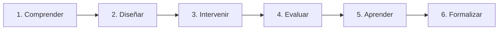
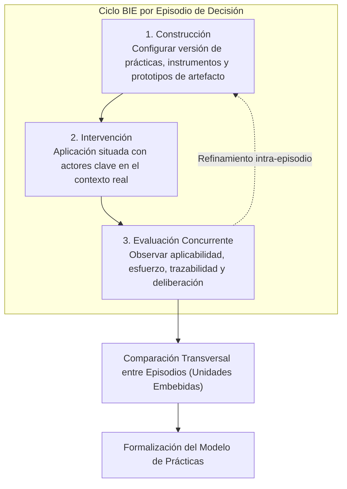

# Fases de Investigación y Ciclos BIE

## La Estrategia General de la Investigación

La investigación sigue una lógica iterativa organizada en torno a seis momentos analíticos que articulan las etapas formales de Action Design Research (ADR):

1. **Comprender**: Diagnosticar la necesidad de decisión, el contexto operativo y las prácticas existentes en la organización.
2. **Diseñar**: Formular prácticas candidatas, criterios de Información Mínima Suficiente (IMS) e instrumentos de trabajo.
3. **Intervenir**: Aplicar las prácticas e instrumentos en episodios reales de decisión con los actores involucrados.
4. **Evaluar**: Analizar concurrentemente la ejecución de las prácticas y los artefactos producidos.
5. **Aprender**: Contrastar lo observado con lo esperado teóricamente, identificando ajustes necesarios.
6. **Formalizar**: Abstraer los hallazgos en un modelo refinado de prácticas transferible analíticamente.

---

## Ciclos de Construcción, Intervención y Evaluación (BIE)

Dentro de ADR (Sein et al., 2011), la etapa central se organiza en **ciclos BIE (Building, Intervention, and Evaluation)**:

Cada episodio de decisión puede constituir uno o más ciclos BIE. Si durante la intervención se descubre que una variable clave no fue capturada, que la regla de parada de la IMS se aplicó prematuramente o que el formato del artefacto no facilita el diálogo entre áreas, la configuración se ajusta y se vuelve a intervenir.

---

## Lógica Operacional de las Prácticas en Cada Ciclo

En cada episodio de decisión se ejecuta la secuencia operacional de las cuatro prácticas candidatas:

1. **Práctica 1: Caracterizar la decisión**
   - *Propósito*: Precisar qué se necesita decidir, el alcance, qué actores participan (negocio, operaciones, TI), qué restricciones operativas o regulatorias existen y qué dependencias deben comprenderse.
2. **Práctica 2: Determinar la Información Mínima Suficiente (IMS)**
   - *Propósito*: A partir de la caracterización, seleccionar las variables indispensables y aplicar la regla de parada (Qi et al., 2024), deteniendo la recolección cuando recopilar más datos no aporta beneficio marginal significativo.
3. **Práctica 3: Estructurar y relacionar la información**
   - *Propósito*: Reconstruir las interacciones socio-técnicas entre procesos, sistemas, herramientas, actores y métricas, utilizando matrices de trazabilidad para hacer visibles los vínculos muchos-a-muchos ($M:N$).
4. **Práctica 4: Configurar el artefacto de decisión**
   - *Propósito*: Traducir la información estructurada en una representación adaptada a la tarea (*Cognitive Fit* - Vessey, 1991) para funcionar como objeto frontera (*Boundary Object* - Kotusev et al., 2023) durante las sesiones de deliberación.

---

## Formalización del Aprendizaje (Etapa Final de ADR)

Al culminar los ciclos BIE y la comparación transversal entre las unidades embebidas, la investigación trasciende el caso particular de Rena Ware International para generar una contribución teórica y metodológica generalizable:

- **Un modelo de prácticas refinadas** de arquitectura empresarial orientadas a la decisión.
- **Relaciones e interdependencias** entre prácticas.
- **Mecanismos de configuración** según los atributos de la decisión.
- **Condiciones de aplicabilidad** que delimitan bajo qué circunstancias organizacionales operan con éxito estas prácticas.

---

## Cronograma Tentativo Doctoral

| Periodo | Actividad Principal | Resultado Esperado |
| :--- | :--- | :--- |
| **Completado** | Revisión sistemática de literatura (RSL) y redefinición del problema. | Matriz de 66 artículos, pregunta de investigación y modelo conceptual consolidado. |
| **Semestre Actual** | Examen de propuesta doctoral (candidatura). | Aprobación de la propuesta e incorporación de recomendaciones del comité. |
| **Semestre +1** | Diseño y refinamiento de instrumentos; selección del conjunto inicial de episodios. | Fichas de decisión, criterios de IMS, rúbricas y diagnóstico del caso. |
| **Semestres +1 a +2** | Primeros ciclos BIE en Servicio al Cliente. | Prácticas y artefactos candidatos aplicados y evaluados en episodios reales. |
| **Semestres +2 a +3** | Nuevos ciclos BIE y comparación entre episodios embebidos. | Evidencia empírica sobre prácticas estables, adaptaciones y mecanismos. |
| **Semestre +3** | Análisis transversal y evaluación rigurosa. | Resultados consolidados sobre aplicabilidad, trazabilidad, suficiencia y deliberación. |
| **Semestres +3 a +4** | Formalización del aprendizaje y redacción de artículos / tesis. | Modelo refinado de prácticas y publicaciones académicas. |
| **Semestre +4** | Cierre y sustentación doctoral. | Documento final y sustentación de grado. |
