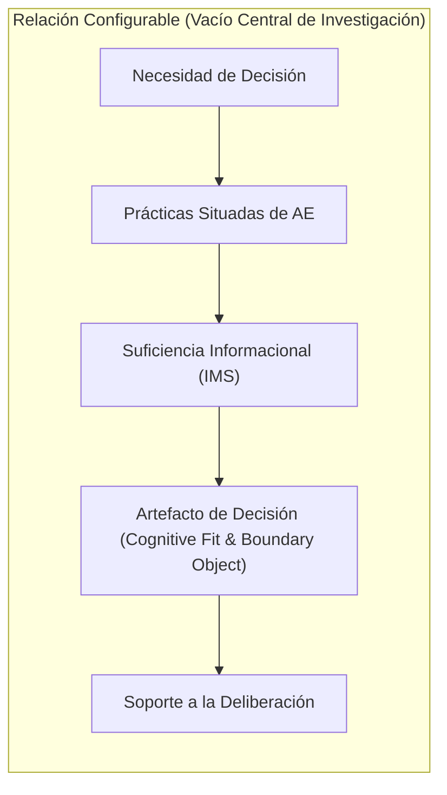

# Vacío de Investigación (Research Gap)

## Fragmentación en la Literatura Científica

La revisión sistemática de literatura demuestra que diversas disciplinas han estudiado elementos aislados del fenómeno, pero mantienen desconectadas sus relaciones prácticas y operacionales:

1. **La literatura de arquitectura empresarial** reconoce que los modelos y diagramas apoyan la alineación estratégica y la toma de decisiones, pero con frecuencia se enfoca en marcos prescriptivos extensos o en la producción de documentación institucional para conservación de conocimiento.
2. **Los estudios sobre prácticas de AE** (Kotusev et al.; Kurnia et al.) han comenzado a analizar las actividades cotidianas de los arquitectos, pero raramente estudian cómo estas prácticas se configuran *ad hoc* a partir de los atributos específicos de una decisión particular.
3. **Las teorías de racionalidad limitada** (Simon, 1955) y **búsqueda informacional** (Qi et al., 2024) explican por qué más datos no equivalen a mejor decisión y justifican la necesidad de reglas de parada, pero estos conceptos no han sido operacionalizados como criterios informacionales dentro de las prácticas de arquitectura empresarial.
4. **La teoría de Cognitive Fit** (Vessey, 1991) demuestra la necesidad de correspondencia entre tarea y representación, pero en el campo de la arquitectura a menudo se continúa imponiendo un único estándar o catálogo rígido de diagramas.
5. **La teoría de Boundary Objects** (Star & Griesemer; Kotusev et al., 2023) explica la función mediadora de los artefactos entre diversas comunidades de negocio y tecnología, pero poco se sabe sobre el proceso previo mediante el cual una práctica situada define qué dependencias y qué nivel de detalle deben incluirse para facilitar la deliberación.

---

## Síntesis del Vacío Identificado

El vacío central que orienta esta investigación no consiste en afirmar que la arquitectura empresarial carece de mecanismos para apoyar decisiones:

> **El verdadero vacío radica en la falta de comprensión sobre cómo se articulan y configuran las prácticas de arquitectura empresarial a partir de una necesidad concreta de decisión, cómo se determina la Información Mínima Suficiente (IMS) para esa situación, y cómo esa información se traduce en un artefacto cuyas características respondan tanto a la tarea decisoria como a los actores que deben deliberar sobre ella.**

---

## Relevancia de Abordar el Gap Mediante Intervención Real

Este vacío no puede resolverse mediante teorización puramente abstracta ni mediante experimentos descontextualizados en laboratorios. Demanda estudiar el fenómeno en un entorno organizacional real con alta complejidad tecnológica, donde coexistan sistemas legados, procesos en estandarización y múltiples actores con intereses diversos.

De allí se deriva la formulación de la pregunta central: **¿Cómo deben ser las prácticas de arquitectura empresarial para apoyar la toma de decisiones?**, y la adopción de Action Design Research (ADR) como estrategia metodológica.
