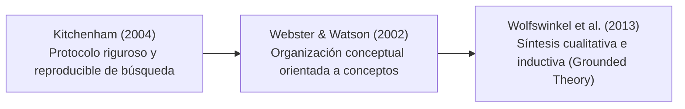

# Revisión Sistemática de Literatura (RSL)

## Protocolo Híbrido de Revisión

Para fundamentar rigurosamente el problema, las preguntas y el modelo conceptual, la propuesta doctoral se sustenta en una **Revisión Sistemática de Literatura (RSL)** diseñada a partir de una estrategia híbrida que combina tres metodologías ampliamente reconocidas en ciencias de la información:

1. **Kitchenham (2004)**: Garantiza la reproducibilidad del protocolo, criterios de inclusión/exclusión y delimitación de cadenas de búsqueda en bases de datos indexadas (Scopus, Web of Science, IEEE Xplore, ACM Digital Library).
2. **Webster y Watson (2002)**: Estructura la literatura mediante una matriz centrada en conceptos (concept-centric), evitando revisiones puramente cronológicas o por autor.
3. **Wolfswinkel et al. (2013)**: Guía el análisis cualitativo y la codificación conceptual para identificar relaciones teóricas emergentes y vacíos de investigación (*gaps*).

La revisión inicial consolidó una base de **66 artículos científicos** seleccionados y analizados.

---

## Bloques Teóricos Clave de la Literatura

La síntesis de los 66 artículos permitió estructurar el marco teórico en seis bloques complementarios:

### 1. Arquitectura Empresarial, Alineación y Toma de Decisiones
- **Aydiner et al. (2019)**: Evidencian que las capacidades de TI no impactan de forma directa el desempeño de la empresa, sino que su valor se media a través del desempeño de los procesos y de la calidad de la toma de decisiones.
- **Chen et al. (2022)**: Relacionan la alineación estratégica negocio–tecnología con la velocidad y pertinencia de las decisiones en entornos dinámicos.
- **De Haes & Van Grembergen (2009); Huygh & De Haes (2019)**: Muestran que la alineación requiere mecanismos relacionales y reconocen que la toma de decisiones es un fenómeno distribuido entre múltiples actores.
- **Bhattacharya (2018)**: Modela cómo articular capacidades, procesos y tecnología mediante arquitectura empresarial.

### 2. Prácticas de Arquitectura Empresarial y Practice Lens
- **Kotusev, Kurnia y colaboradores (2020, 2021)**: Describen la arquitectura empresarial no como un marco estático, sino como una *práctica organizacional* compuesta por actividades situadas, participantes y artefactos.
- **Orlikowski (2000)**: Aporta la *practice lens* sociotécnica, enfatizando que las estructuras no actúan por sí solas, sino a través de las acciones que los actores ejecutan en su trabajo cotidiano frente a necesidades concretas.
- Permite separar con rigor tres elementos: **la práctica** (acción situada), **el artefacto** (representación resultante) y **la herramienta** (mecanismo técnico).

### 3. Racionalidad Limitada y Sobrecarga Informacional
- **Simon (1955)**: Principio fundacional de racionalidad limitada; los decisores no pueden procesar toda la información existente ni evaluar exhaustivamente todas las alternativas posibles.
- **Bettis-Outland (2012); Tarka (2017)**: Advierten sobre la sobrecarga informacional (*information overload*), demostrando que disponer de más datos no se traduce en mejores decisiones si satura la capacidad cognitiva del equipo.
- **Qi, Han & Hansen (2024)**: Proponen un modelo conductual de búsqueda y parada: la recolección de información debe detenerse cuando el costo marginal de continuar buscando supera el beneficio marginal esperado para la decisión. Este principio sustenta la **Información Mínima Suficiente (IMS)**.

### 4. Representación y Ajuste Cognitivo (Cognitive Fit)
- **Vessey (1991)**: La teoría de *Cognitive Fit* demuestra que el desempeño en una tarea mejora significativamente cuando la representación gráfica se ajusta a las características intrínsecas de la tarea analizada.
- Fundamenta por qué la investigación rechaza imponer un único formato o canvas cerrado para todas las decisiones.

### 5. Artefactos de AE como Objetos Frontera (Boundary Objects)
- **Star & Griesemer; Kotusev, Kurnia & Dilnutt (2023)**: Analizan empíricamente cómo los artefactos de arquitectura empresarial operan como *Boundary Objects* entre comunidades con vocabularios, prioridades y conocimientos divergentes (directivos, líderes de procesos y equipos de TI), posibilitando una visión compartida y el diálogo constructivo.

### 6. Complejidad Socio-Técnica y Trazabilidad
- **Ben Hassen et al. (2025)**: Analizan las fallas de ajuste multidimensional (*three-fit problem*) entre sistemas y procesos.
- **Bidmeshk et al. (2025)**: Evidencian que las relaciones entre actividades de negocio y tareas de software exhiben estructuras muchos-a-muchos ($M:N$), requiriendo trazabilidad explícita para evitar que las dependencias críticas queden invisibles.
- **van Heesch et al. (2012, 2014)**: Destacan la importancia de estructurar y registrar explícitamente decisiones arquitectónicas (*Architecture Decision Records - ADR* y revisiones centradas en decisiones).
