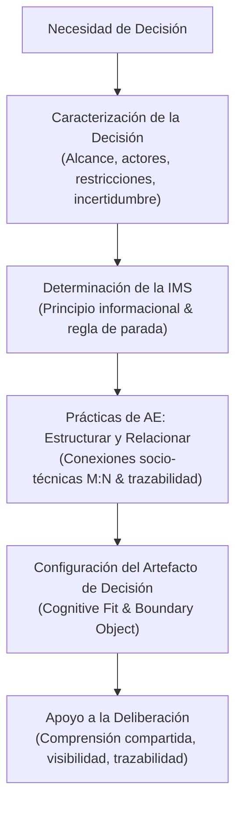

# Visión General de la Investigación

## Contexto y Planteamiento del Problema

Las organizaciones con alta dependencia tecnológica operan mediante relaciones complejas y permanentes entre personas, procesos, sistemas e información. En este contexto, la tecnología no genera valor de forma aislada, sino a través de la manera en que se articula con los procesos de negocio y con las decisiones que estos demandan (Aydiner et al., 2019; Chen et al., 2022).

Sin embargo, **disponer de sistemas, documentación y datos no garantiza que exista una comprensión suficiente para decidir**. La información necesaria suele encontrarse dispersa entre herramientas, repositorios, reuniones y actores, mientras que las relaciones entre procesos, sistemas, métricas y dependencias permanecen implícitas. La literatura sobre sobrecarga informacional (*information overload*) advierte que incrementar el volumen de datos disponibles no mejora la decisión si esta información no puede ser procesada y valorada eficazmente (Bettis-Outland, 2012; Tarka, 2017).

Asimismo, los problemas de alineación negocio–TI suelen manifestarse como desajustes verticales, horizontales y transversales (*three-fit problem*, Ben Hassen et al., 2025). Respaldar una decisión exige comprender no solo los componentes tecnológicos aislados, sino también las relaciones entre actores y estructuras en decisiones que tienen un carácter intrínsecamente distribuido (De Haes & Van Grembergen, 2009; Huygh & De Haes, 2019).

Aunque la arquitectura empresarial ofrece marcos y modelos para hacer explícitas estas relaciones, persiste la necesidad de entender **cómo sus prácticas pueden orientarse directamente al apoyo de la toma de decisiones**.

---

## El Cambio de Enfoque

La investigación parte de una transición fundamental:

> **Pasar de una lógica predominantemente documental hacia una lógica orientada a artefactos de decisión.**

Esto no implica descartar la documentación tradicional, sino comprender cómo el conocimiento arquitectónico puede estructurarse y representarse en función de una necesidad concreta de decisión.

---

## Pregunta de Investigación

La formulación que guía la tesis doctoral es:

> ### **¿Cómo deben ser las prácticas de arquitectura empresarial para apoyar la toma de decisiones?**

Esta pregunta centra el objeto de estudio en las **prácticas de arquitectura empresarial** entendidas como acciones situadas. El interés no radica únicamente en identificar qué prácticas existen, sino en comprender cómo se configuran, cómo se relacionan entre sí, cómo responden a diferentes necesidades decisionales y qué mecanismos permiten que produzcan artefactos útiles para apoyar la deliberación.

---

## Subpreguntas de Investigación

La pregunta principal se desagrega en seis subpreguntas que siguen la secuencia conceptual del fenómeno:

- **SQ1**: ¿Qué características de una decisión son relevantes para configurar prácticas de arquitectura empresarial orientadas a apoyarla?
- **SQ2**: ¿Cómo determinar la información mínima suficiente necesaria para apoyar una decisión a partir de sus características?
- **SQ3**: ¿Cómo deben configurarse las prácticas de arquitectura empresarial para estructurar y relacionar la información relevante para una decisión?
- **SQ4**: ¿Qué características deben tener los artefactos de decisión y cómo se relacionan con las características de la decisión y con la información considerada suficiente?
- **SQ5**: ¿Cómo se comportan y refinan estas prácticas y los artefactos que producen al aplicarse en episodios reales de decisión?
- **SQ6**: ¿En qué condiciones las prácticas y los artefactos producidos apoyan la comprensión, la trazabilidad y la deliberación entre los actores involucrados?

---

## Objetivos de la Investigación

### Objetivo General
**Diseñar y evaluar un modelo de prácticas de arquitectura empresarial orientadas a apoyar la toma de decisiones**, articulando la caracterización de la decisión, la determinación de la información mínima suficiente y la configuración de artefactos de decisión.

### Objetivos Específicos
- **OE1**: Caracterizar las necesidades de decisión e identificar los atributos relevantes para configurar prácticas de arquitectura empresarial y artefactos de decisión.
- **OE2**: Definir criterios para determinar la información mínima suficiente requerida de acuerdo con las características de una decisión.
- **OE3**: Diseñar prácticas candidatas de arquitectura empresarial que permitan estructurar, relacionar y representar la información relevante para una necesidad de decisión.
- **OE4**: Caracterizar y configurar artefactos de decisión a partir de las características de la decisión y de la información considerada suficiente.
- **OE5**: Aplicar y refinar las prácticas y artefactos propuestos mediante ciclos de intervención en episodios reales de decisión del área de Servicio al Cliente de Rena Ware International.
- **OE6**: Evaluar las prácticas y sus resultados para identificar su aplicabilidad, los mecanismos que las relacionan y las condiciones bajo las cuales apoyan la comprensión, la trazabilidad y la deliberación.

### Matriz de Articulación Preguntas vs. Objetivos

| Subpregunta | Objetivo Específico | Foco de Indagación |
| :--- | :--- | :--- |
| **SQ1. Características de la decisión** | **OE1** | Atributos y dimensiones de la decisión que condicionan las prácticas. |
| **SQ2. Información suficiente** | **OE2** | Criterios operativos y regla de parada de la IMS. |
| **SQ3. Configuración de prácticas** | **OE3** | Diseño de prácticas situadas candidatas. |
| **SQ4. Características del artefacto** | **OE4** | Configuración de representaciones (Cognitive Fit y Boundary Objects). |
| **SQ5. Comportamiento y refinamiento** | **OE5** | Intervención empírica mediante ciclos BIE en contexto real. |
| **SQ6. Evaluación y condiciones** | **OE6** | Evaluación en dos niveles y formalización del modelo de prácticas. |

---

## Modelo Conceptual

El modelo conceptual articula los elementos centrales de la investigación en una secuencia flexible y situada:

---

## Delimitación del Alcance

Para garantizar rigor y validez:
1. **El alcance llega hasta la configuración, uso y evaluación de los artefactos de decisión producidos mediante estas prácticas.**
2. **No se pretende demostrar causalidad directa sobre el desempeño organizacional posterior ni afirmar que su aplicación conduce automáticamente a mejores decisiones**, reconociendo la complejidad de las dinámicas empresariales que trascienden el momento de deliberación.
